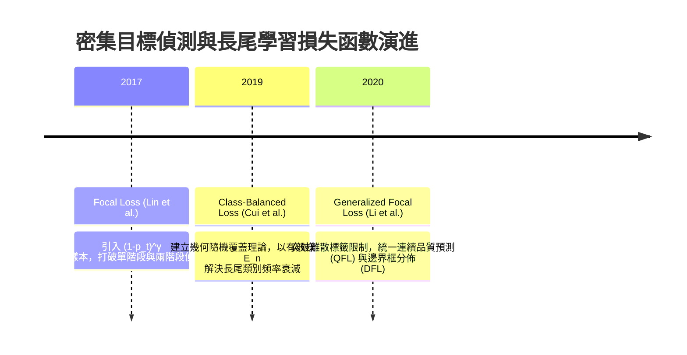

# 類別不平衡與聚焦損失演進史

## 技術演進全景圖

---

## 三大核心損失演化維度對比

| 比較維度 | Focal Loss (2017) | Class-Balanced Loss (2019) | Generalized Focal Loss (2020) |
|---|---|---|---|
| **核心解決痛點** | 單階段極端前景-背景不平衡（1:1000） | 長尾極端類別分佈、逆頻率加權發散 | 品質-分類預測不一致、邊界框不確定性 |
| **目標標籤類型** | 離散二元標籤 $y \in \{0, 1\}$ | 離散多類別標籤 $y \in \{1, \dots, C\}$ | **任意連續標籤** $y \in [y_l, y_r]$ |
| **調變聚焦機制** | 樣本預測機率差 $(1 - p_t)^\gamma$ | 有效樣本數倒數 $1/E_{n_y} = \frac{1-\beta}{1-\beta^{n_y}}$ | 連續預測偏差絕對值 $|y - \hat{y}|^\beta$ |
| **對邊界框回歸支援** | 僅支援分類（回歸另採 Smooth L1） | 僅支援分類 | **深度整合邊界框通用機率分佈（DFL）** |
| **代表性任務 / 基準** | COCO 密集目標偵測（[[retinanet\|RetinaNet]]） | iNaturalist、長尾 CIFAR | COCO SOTA 密集目標偵測（ATSS、FCOS） |

---

## 關鍵數學演進細節

### 1. 從 Focal Loss 到 CB Focal Loss（加入長尾維度）
原始 Focal Loss 中的 $\alpha_t$ 為手動微調的常數（如 $\alpha = 0.25$）。Cui et al. (2019) 證明隨著樣本數增加，新樣本的特徵覆蓋重疊率提高，因此以有效樣本數倒數嚴格推導出 $\alpha_t$ 的動態計算式：
$$\text{CB}_{\text{focal}} = -\frac{1 - \beta}{1 - \beta^{n_y}} \sum_{i=1}^C (1 - p_i^t)^\gamma \log(p_i^t)$$
完成了從「純樣本難度加權」到「難度 + 類別資訊容量雙重加權」的升級（見 [[2019-class-balanced-loss]]）。

### 2. 從 Focal Loss 到 Generalized Focal Loss（走向連續空間）
傳統 Focal Loss 無法處理連續的真值（如連續 IoU 分數 $y \in [0, 1]$）。GFL 將 $(1-p_t)^\gamma$ 泛化為連續絕對偏差 $|y - \hat{y}|^\beta$，並將二元交叉熵推廣至包含兩端機率的完全交叉熵：
$$\text{GFL}(p_{y_l}, p_{y_r}) = -|y - (y_l p_{y_l} + y_r p_{y_r})|^\beta \big((y_r - y)\log(p_{y_l}) + (y - y_l)\log(p_{y_r})\big)$$
由此自然推導出 **QFL**（聯合分類與真實 IoU）與 **DFL**（任意離散分佈邊界框回歸），將分類與回歸損失統一在聚焦學習的數學框架下（見 [[2020-generalized-focal-loss]]）。

---

## 參考來源
- [[2017-focal-loss]]
- [[2019-class-balanced-loss]]
- [[2020-generalized-focal-loss]]
- [[focal-loss]]
- [[generalized-focal-loss]]
- [[class-balanced-loss]]
