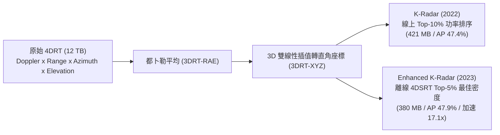

# 4D 雷達張量與稀疏化（4D Radar Tensor & Sparsification）

## 定義與背景
在自動駕駛毫米波雷達感知中，資料表徵主要分為兩大流派：
1. **4D 雷達點雲（Radar Point Cloud, RPC）**：雷達硬體在韌體端經過 CFAR（恆虛警率）門檻濾波後輸出的離散點（包含 3D 座標、都卜勒速度與強度）。優點是資料量小，缺點是門檻濾波過早抹除了微弱但真實的空間環境特徵。
2. **4D 雷達高維張量（4D Radar Tensor, 4DRT）**：直接保留 FFT 運算後的高維能量功率矩陣，包含四個物理維度：**都卜勒速度（Doppler）、距離（Range）、方位角（Azimuth）與俯仰角（Elevation）**。

---

## 4DRT 的表徵管線（以 [[k-radar-dataset|K-Radar]] 為例）
- 原始張量維度：$64(\text{Doppler}) \times 256(\text{Range}) \times 107(\text{Azimuth}) \times 37(\text{Elevation})$。
- **都卜勒壓縮**：沿都卜勒軸平均池化，將張量降至三維空間功率分佈 `3DRT-RAE`。
- **極座標至直角座標插值**：藉由 3D 雙線性插值轉為笛卡爾空間網格 `3DRT-XYZ`。

---

## 稀疏化權衡與 4DSRT 突破
保留完整 4DRT 帶來了巨大的儲存（單套資料集 12 TB）與線上雙線性插值計算開銷。如何對高維張量進行最優稀疏化，是近年的關鍵研究議題：

### 觀點演進：雷達張量密度並非越稠密越好
- **K-Radar (2022)** 啟發式地保留 **Top-10%** 功率最高點作為 3D 稀疏張量 $(X, Y, Z, \text{PW})$，並以 3D-SCB（3D 稀疏卷積）進行目標偵測（見 [[2022-k-radar]]）。
- **Enhanced K-Radar (2023)** 提出了離線預計算的 **4DSRT**，並進行了 $0.01\% \sim 50\%$ 的系統性密度消融（見 [[2023-enhanced-k-radar]]）：
  - **最佳平衡點落在 5%**：在 5% 密度下取得最高 $AP_{\text{3D}}$（**47.9%**），且 GPU 記憶體降至 380 MB；
  - **稠密度的負面影響**：當密度推高至 15%~50% 時，記憶體大幅膨脹至 802 MB，但精度停滯衰退；特別在冰霰（Sleet）與惡劣天氣下，過高的密度保留了大量地面反光與散射雜訊，導致 AP 暴跌。

---

## 參考來源
- [[2022-k-radar]]
- [[2023-enhanced-k-radar]]
