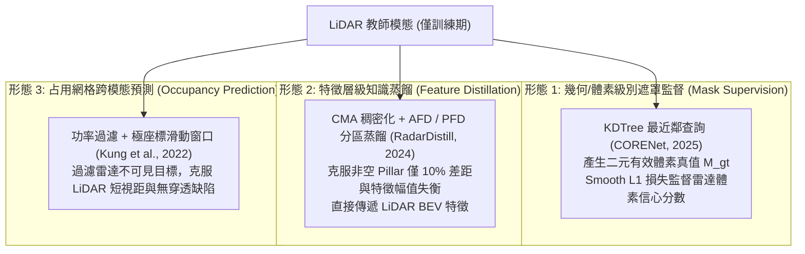

# 跨模態監督學習（Cross-Modal Supervision）

## 定義與定位
**跨模態監督學習（Cross-Modal Supervision）** 是一種非對稱的多模態學習範式：在**訓練階段**引入資訊更豐富或精度更高的輔助模態（Teacher Modality，例如 LiDAR 或 2D 語意影像）作為監督訊號，引導目標模態（Student Modality，例如 3D / 4D 毫米波雷達）學習表徵、過濾雜訊或預測空間占用；在**推論階段**則完全移除輔助模態，僅使用單一目標模態進行高效部署。

---

## 核心機制與三大主流形態

1. **幾何體素真值遮罩監督（Geometric Mask Supervision）**
   - 代表作：[[corenet|CORENet]]（見 [[2025-corenet]]）。
   - 做法：在訓練時以 KDTree 對同步 LiDAR 點雲進行半徑 $\tau = 0.5\text{ m}$ 鄰近查詢，產生體素級有效遮罩 $M_{\text{gt}}$，透過 Smooth $L_1$ 損失訓練雷達網路預測雜訊遮罩。
2. **BEV 特徵層級知識蒸餾（Cross-Modality Feature Distillation）**
   - 代表作：[[radardistill|RadarDistill]]（見 [[2024-radardistill]]）。
   - 做法：針對雷達非空 Pillar 僅 LiDAR 約 10% 的極端稀疏性，先以 CMA 模組將雷達特徵膨脹稠密化，再以活化區域分流（AFD）與通道 Softmax 正規化提案蒸餾（PFD）拉近雷達與 LiDAR BEV 表徵。
3. **極座標占用網格跨模態映射（Polar Occupancy Prediction）**
   - 代表作：Kung et al., RA-L 2022（見 [[2022-radar-occupancy-prediction]]）。
   - 做法：在極座標空間訓練 U-Net 預測網格占用，藉由極座標滑動窗口將近距離 LiDAR 監督擴展至超遠距（$160\text{ m} \sim 500\text{ m}$）與遮擋物後方。

---

## 跨模態監督的物理陷阱（Pitfalls of Cross-Modal Supervision）
> [!WARNING] 感測器物理失配引發的負面監督（Negative Supervision）
> 根據 [[2022-radar-occupancy-prediction]] 的深刻剖析，直接將 LiDAR 作為雷達真值會引發嚴重的物理衝突：
> 1. **雷達看不見、LiDAR 看得見（微小結構）**：細樹枝或草叢會產生 LiDAR 點但雷達回波極弱；若強制監督，會迫使神經網絡在雷達空白區域過度擬合產生幻覺（Hallucination）。解決方案：**設定雷達功率門檻過濾 LiDAR 真值（Power Thresholding）**。
> 2. **雷達穿透得到、LiDAR 視距被擋（遮擋目標）**：毫米波能穿透前車底盤或雨霧，而 LiDAR 為嚴格視距感測器；直接以 LiDAR 為真值會錯誤懲罰雷達珍貴的穿透信號。解決方案：**極座標滑動窗口推論，使遮擋回波在後續窗口成為首個回波**。
> 3. **特徵維度稀疏度與幅值失衡**：直接將 dense LiDAR 與 sparse radar 進行特徵對齊會導致大量無效梯度。解決方案：**先膨脹稠密化（CMA），並採用通道正規化（PFD）**。

---

## 與推論期多模態融合的對比
- 詳見專題分析頁：[[cross-modal-supervision-vs-fusion|跨模態監督 vs. 推論期多模態融合橫向評比]]。

---

## 參考來源
- [[2025-corenet]]
- [[2024-radardistill]]
- [[2022-radar-occupancy-prediction]]
