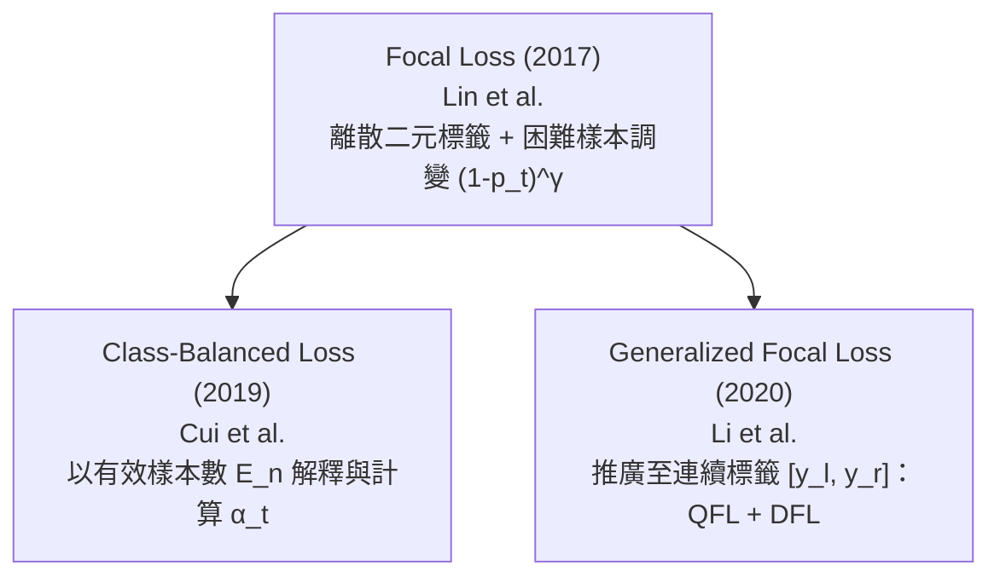

# Focal Loss（聚焦損失）

## 定義與定位
**Focal Loss (FL)** 由 Lin et al. (FAIR, 2017) 提出（見 [[2017-focal-loss]]），專為解決單階段目標偵測中極端的前景-背景類別不平衡問題（約 $1:1000$）。其核心精神在於藉由引入動態調變因子 $(1 - p_t)^\gamma$，降低大量容易分類的背景樣本（Easy Negatives）在損失與梯度中所佔的比重，迫使模型專注於少數困難樣本（Hard Examples）。

---

## 核心數學機制
$$\text{FL}(p_t) = -\alpha_t (1 - p_t)^\gamma \log(p_t)$$
- **調變因子 $(1 - p_t)^\gamma$**：當樣本預測機率 $p_t \to 1$（如簡單背景），權重急劇衰減為 0；當 $p_t$ 較小（困難樣本），權重接近 1。
- **最佳實務超參數**：$\gamma = 2.0, \alpha = 0.25$。
- **先驗偏置初始化（Prior Initialization, $\pi$）**：
  輸出層偏置初始化為 $b = -\log((1-\pi)/\pi)$（令 $\pi = 0.01$），防止訓練最初期龐大背景負樣本產生巨大梯度破壞網路穩定性。

---

## 演進與技術派生脈絡

1. **[[class-balanced-loss|Class-Balanced Loss (2019)]]**：提出幾何隨機覆蓋理論，指出樣本重疊邊際效益遞減，以有效樣本數 $E_n = (1-\beta^n)/(1-\beta)$ 為 Focal Loss 提供了非參數化的 $\alpha_t$ 計算標準（見 [[2019-class-balanced-loss]]）。
2. **[[generalized-focal-loss|Generalized Focal Loss (2020)]]**：將 Focal Loss 突破離散 $\{0, 1\}$ 限制，擴展至任意連續目標，解決了分類-品質預測不一致與邊界框不確定性問題（見 [[2020-generalized-focal-loss]]）。

---

## 在 3D 自駕感知中的普遍應用
在 3D 體素與點雲感知中，空間網格大多為空，正負樣本比例往往更極端（$1:10000$ 以上），Focal Loss 已成為各大 3D 偵測器的標準配置：
- [[corenet|CORENet]] 分類損失（見 [[2025-corenet]]）；
- [[l4dr|L4DR]] 的 FAD 前景分割與物件分類損失（見 [[2025-l4dr]]）；
- [[k-radar-dataset|K-Radar]] 的 RTNH 稀疏卷積分類損失（見 [[2022-k-radar]]）。

---

## 參考來源
- [[2017-focal-loss]]
- [[2019-class-balanced-loss]]
- [[2020-generalized-focal-loss]]
