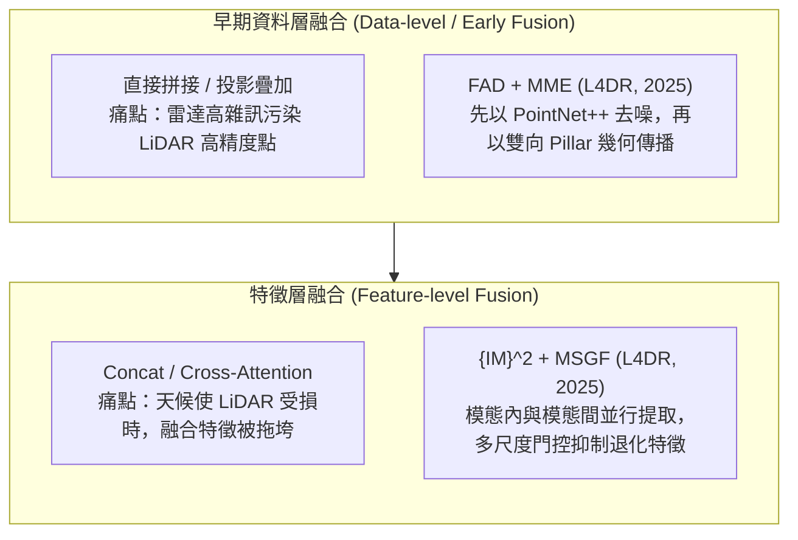

# LiDAR 與雷達多模態融合（LiDAR-Radar Multi-Modal Fusion）

## 定義與定位
**LiDAR-Radar 多模態融合** 指的是在自駕車載感知端**同時搭載並即時運行（Runtime Inference）** LiDAR 與毫米波雷達（包含 3D 與 4D 雷達），透過演算法互補兩者在物理幾何解析度與極端天候抗擾度上的缺陷。

這與**跨模態監督 / 知識蒸餾**（如 [[corenet|CORENet]]、[[radardistill|RadarDistill]] 僅在訓練時需要 LiDAR）形成鮮明對比：推論期多模態融合需要承擔更高的硬體感測器成本與車端推論功耗，但能為自動駕駛提供冗餘的「全天候物理安全防護」。

---

## 核心融合層級與演進

### 1. 早期融合（Early Fusion）：從粗暴疊加到前置去噪
- **痛點**：早期研究直接將雷達點與 LiDAR 點在空間網格中結合，但 4D 雷達的多路徑旁瓣雜訊極其強烈，反而降低了清晰天候下 LiDAR 的精確度。
- **現代解決方案（以 [[l4dr|L4DR]] 為例）**：
  - 引入 **FAD（前景感知去噪）**：先以 [[pointnet-plus-plus|PointNet++]] 預測雷達點的前景機率並剔除雜訊點；
  - 引入 **MME（雙向多模態編碼器）**：在 Pillar 內雙向補足雷達都卜勒速度/RCS 與 LiDAR 反射率幾何資訊（見 [[2025-l4dr]]）。

### 2. 特徵層融合（Feature-level Fusion）：從強制混合到自適應門控
- **痛點**：在雨、霧、大雪場景下，LiDAR 點雲密度急劇衰退（甚至降至 10% 以下），若神經網路採用硬性拼接（Concat），受損的 LiDAR 特徵會污染雷達特徵。
- **現代解決方案（以 [[l4dr|L4DR]] 為例）**：
  - **$\{\text{IM}\}^2$ 並行骨幹**：同時保留純 LiDAR、純雷達與跨模態融合三條特徵流；
  - **MSGF 多尺度門控**：動態依據融合情境計算門控權重，當某模態在惡劣天候退化時，自動抑制該分支的特徵權重。

---

## 惡劣天候下的對比表現（參考 [[k-radar-dataset|K-Radar]] 與 [[vod-dataset|VoD-Fog]]）
- 在晴天良好環境下，LiDAR 3D 偵測 AP 佔優；
- 在**濃霧（Fog Level 4）**下，純 LiDAR 偵測 mAP 從 70.3% 暴跌至 **8.92%**；而配備 L4DR 的融合模型仍能維持 **28.9%** 的高精度（維持超過 3 倍效能）。
- 在**冰霰（Sleet）與大雪**天候下，4D 雷達維持 40% 以上的 3D AP，彌補了 LiDAR 表面覆雪結霜的致命缺陷。

---

## 參考來源
- [[2025-l4dr]]
- [[2022-k-radar]]
- [[2024-radardistill]]
